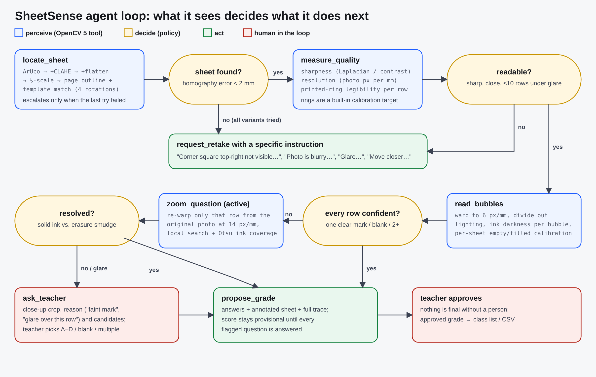

# SheetSense: an OpenCV 5 agent that grades MCQ answer sheets from a phone photo

A teacher prints the SheetSense answer sheet, photographs each student's filled sheet with any phone, and gets a proposed grade in about two seconds. An agent built on **OpenCV 5** finds and straightens the page, reads all 160 bubbles, retries what it could not see clearly, asks for a specific retake when the photo is unusable, and hands the teacher a close-up of every answer it is unsure of. **No grade is final until a teacher approves it.** The app runs on **AWS Lambda (arm64 / Graviton)**.

- Live app: `https://5omclyghhagcueiorjtjc4ieou0bfdzg.lambda-url.ap-south-1.on.aws/` (or try `?sample=review` for a ready-made example)
- Technical report: [REPORT.md](REPORT.md)
- Diagrams: [docs/architecture.png](docs/architecture.png), [docs/agent-loop.png](docs/agent-loop.png)
- Evaluation results: [results/test/summary.json](results/test/summary.json)



## Results (held-out synthetic test set, 230 photos, 7,600 questions)

| | Single-pass baseline | SheetSense agent |
|---|---|---|
| Wrong answers recorded with no warning (silent errors) | 64 (8.4 per 1,000 questions) | **0** |
| Answers decided automatically | 98.9 % | 95.5 % |
| Answers sent to the teacher with a close-up | 0 % | 1.9 % (0.76 per sheet) |
| Unusable photos (blur, glare, occlusion, too far) caught | 21 / 40 | **40 / 40** |
| Silent errors on the unusable photos it graded anyway | 126 | **0** |
| Good photos wrongly sent back for a retake | 2 / 190 | 5 / 190 |
| Median time per photo (local x86 CPU) | 197 ms | 466 ms |

The test set is synthetic: printed sheets rendered from the real template, filled with pen/pencil marks, erasures, faint marks, double marks and blanks, then "photographed" with random perspective, lighting gradients, shadows, glare, blur, noise and JPEG compression. It was generated with seed 7777. The thresholds were tuned on a separate dev set (seed 2026). The report covers the limits of this method; the main one is that real phone photos have not yet been measured at scale.

## Quick start (local)

Requires Python 3.14 (the same version as the Lambda runtime).

```bash
python3.14 -m venv .venv && . .venv/bin/activate
pip install -r requirements-dev.txt          # pinned: opencv-python-headless 5.0.0.93, numpy 2.5.4
python -m pytest -q                           # 11 tests
python -m app.local_server 8080               # http://127.0.0.1:8080
```

Grade a photo from the command line:

```bash
python - <<'EOF'
import cv2, json
from sheetsense.agent import GradingAgent
r = GradingAgent(render=False).run(cv2.imread("app/static/sample-review.jpg"))
print(r.status, r.answers, [x["q"] for x in r.review])
print(json.dumps([s.__dict__ for s in r.trace], indent=1))
EOF
```

## Reproduce the evaluation

```bash
python -m eval.synth --out data/dev  --seed 2026 --scale 0.1   # dev set used for tuning (23 photos)
python -m eval.synth --out data/test --seed 7777               # held-out test set (230 photos)
python -m eval.run_eval --data data/test --out results/test    # agent, ablations, baseline (about 25 min on one CPU core)
```

## Deploy to AWS

Needs the AWS CLI with credentials. The script is idempotent; re-run it to update.

```bash
AWS_REGION=ap-south-1 ./deploy/deploy.sh      # prints the Function URL and the CloudWatch dashboard link
python -m eval.bench_endpoint https://5omclyghhagcueiorjtjc4ieou0bfdzg.lambda-url.ap-south-1.on.aws/ --n 20
./deploy/teardown.sh                          # removes everything
```

What it creates:
- a Lambda function: arm64, Python 3.14, 2 GB, 30 s, zip built from the pinned aarch64 wheels
- a public Function URL
- an IAM role that can only write logs
- a private, encrypted S3 bucket for deploy artifacts
- 14-day log retention
- a CloudWatch dashboard

The dashboard shows latency, outcomes, review load and tool calls per request, all taken from Embedded Metric Format log lines.

## Repository layout

```
sheetsense/template.py   printable A4 layout (ArUco corner markers, 40 x A-D bubbles), all in millimetres
sheetsense/vision.py     OpenCV 5 tools: locate (ArUco / page outline + template match), quality, read, zoom
sheetsense/agent.py      perception -> decision -> action policy, trace, annotation
app/handler.py           Lambda handler (Function URL): web app, /api/grade, /api/health, EMF metrics
app/static/              web app, printable sheet (PDF/PNG), demo photos
eval/synth.py            seeded generator of phone-style photos with exact ground truth
eval/run_eval.py         metrics for the agent, ablations (no zoom, no review) and single-pass baseline
eval/bench_endpoint.py   end-to-end latency of the deployed endpoint
deploy/                  deploy.sh, teardown.sh, CloudWatch dashboard
tests/                   pytest
tools/                   asset builder, SVG->PNG
```

## Responsible use

- **The teacher decides.** The agent proposes; a person approves every grade, and anything uncertain is shown to them with the evidence.
- **Privacy.** Photos are resized in the browser, processed in memory, and never written to disk, S3 or logs. Student names never leave the teacher's browser.
- **Not for high-stakes exams** without a local validation on real sheets first. See the report's limitations section.
