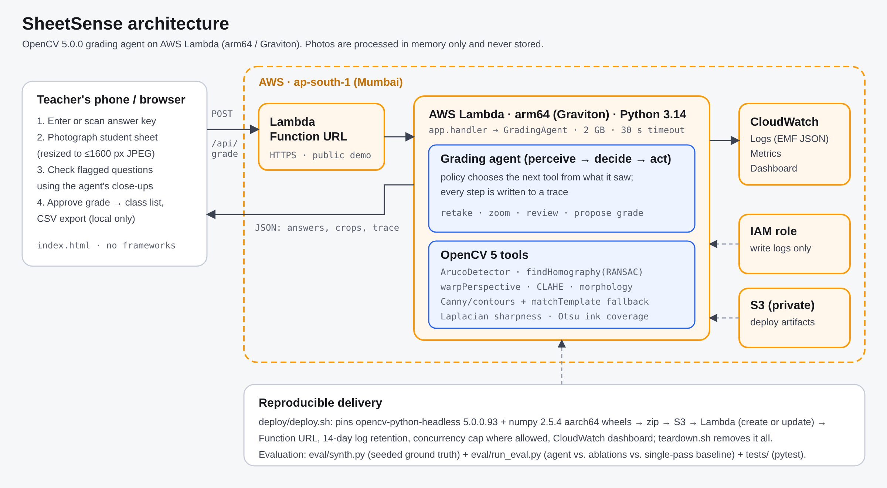

# SheetSense: technical report

**OpenCV AI Competition 2026, powered by AWS** · Path: Agentic Vision with OpenCV 5 (and Overall)

**Team:** solo entry (Devpost: trendcatcher299), Pakistan

**Live app:** https://5omclyghhagcueiorjtjc4ieou0bfdzg.lambda-url.ap-south-1.on.aws/ · **Code:** https://github.com/TrendCatcher2/sheetsense

## 1. Problem and users

Multiple-choice tests are used widely in schools across Pakistan and South Asia: board-exam practice, weekly class tests, entrance-test coaching. Teachers mark them by hand. One class of 40 students with 40 questions is 1,600 answers to check, and that kind of repetitive checking is where mistakes slip in. Commercial OMR scanners solve this but need special forms, dedicated hardware and money that most schools and tuition centres do not have. Phone-based OMR apps exist. The risk we target is any reader that makes one pass over the photo and reports whatever it read. A blurry photo, a glare spot or an erased answer becomes a wrong grade that nobody notices.

**Users:** classroom teachers, tuition and coaching centres, and NGO-run schools. What they have is a phone and a printer, not a scanner.
**Beneficiaries:** students, who get a grade a teacher has actually checked.

**Goal:** turn a phone photo of a printed answer sheet into a grade quickly, and **never record a wrong answer silently**. Anything the system cannot read reliably is either re-measured, sent back for a retake with a specific instruction, or shown to the teacher.

## 2. What the system does

1. The teacher prints the SheetSense sheet (A4, 40 questions A–D, four ArUco corner markers). They can download it from the app.
2. They enter the answer key or photograph a filled key sheet.
3. For each student they take a photo. The browser resizes it to at most 1600 px and sends it to the AWS Lambda endpoint.
4. The **agent** runs a perception → decision → action loop over OpenCV 5 tools and returns one of three outcomes:
   - **READY:** every answer was read confidently.
   - **NEEDS_REVIEW:** some questions are sent to the teacher with a close-up crop, a reason ("faint mark", "glare over this row") and the likely candidates.
   - **RETAKE:** a specific instruction: which corner marker is hidden, that the photo is blurry, that there is glare, or that the phone should move closer.
5. The teacher resolves any flagged questions and approves. The grade is then added to the class list, which can be exported as CSV.

## 3. Architecture



| Layer | Implementation |
|---|---|
| Client | Single static page (`app/static/index.html`). Camera capture, in-browser resize, review UI, approval, CSV export. No frameworks. Student names stay in the browser. |
| API | AWS Lambda Function URL (HTTPS). `POST /api/grade`, `GET /api/health`, static assets. |
| Compute | AWS Lambda, **arm64 (Graviton)**, Python 3.14, 2 GB, 30 s timeout. Code is a zip of pinned aarch64 wheels: `opencv-python-headless==5.0.0.93`, `numpy==2.5.4`. |
| Agent + vision | `sheetsense/agent.py` (policy, trace) and `sheetsense/vision.py` (OpenCV 5 tools). |
| Observability | One structured log line per request in CloudWatch **Embedded Metric Format**. Latency, outcome, review count and tool calls become metrics with no extra API calls. A CloudWatch dashboard is deployed by script, and Logs Insights shows recent decisions. |
| Security | An IAM execution role that can only write logs. A private, encrypted S3 bucket holds deploy artifacts. Photos are never persisted. Input limits: 4 MB, 4000 px, JSON validation. No stack traces are returned to clients. Security headers and CSP are set. A reserved-concurrency cap is applied where the account allows it. |
| Delivery | `deploy/deploy.sh` is idempotent and does build → S3 → create/update → URL → dashboard. `deploy/teardown.sh` removes all of it. |

## 4. OpenCV 5 implementation

All image analysis uses OpenCV 5.0.0 (`opencv-python-headless 5.0.0.93`):

- **Sheet localisation.**
  - `cv2.aruco.ArucoDetector` (DICT_4X4_50, sub-pixel corner refinement) finds the four corner markers. Their 16 corners give a RANSAC homography (`cv2.findHomography`) to a millimetre page frame.
  - Marker IDs encode orientation, so upside-down and sideways photos are rectified correctly.
  - The reprojection error is checked: more than 2 mm means the markers don't fit the sheet geometry, and the location is rejected.
  - Three of four markers are enough.
- **Escalating fallbacks.** These run only when the previous step failed:
  - CLAHE (`cv2.createCLAHE`)
  - illumination flattening (morphological closing + `cv2.divide`)
  - half-scale detection
  - page outline detection (`cv2.Canny` → `cv2.findContours` → `cv2.approxPolyDP`), followed by `cv2.matchTemplate` against the rendered template in all four rotations to pick the orientation
- **Quality measurement on the rectified sheet:**
  - **Sharpness:** RMS of `cv2.Laplacian` normalised by local contrast, so dim photos are not called blurry.
  - **Resolution:** photo pixels per paper millimetre, from the inverse homography.
  - **Glare:** the printed bubble rings act as a **built-in calibration target**. If a ring has lost its contrast, whatever is inside it can't be trusted either. Each ring is checked individually.
- **Reading.**
  - `cv2.warpPerspective` to 6 px/mm.
  - Lighting gradients and shadows are divided out using a morphological-closing background.
  - Mean ink darkness is measured inside a 62 % disk of each bubble, which excludes the printed ring.
  - Scores are normalised per sheet against the sheet's own empty and filled levels, so pen, pencil, paper and exposure differences cancel out.
- **Active perception (zoom).**
  - For an uncertain question, the agent re-warps only that row **directly from the original photo** at 14 px/mm, using cubic interpolation.
  - It searches a small window around each bubble to absorb registration error.
  - It adds a second, independent measurement: **ink coverage**, the fraction of pixels below a local Otsu threshold (`cv2.threshold` with `THRESH_OTSU`).
  - Coverage separates a solid fill from an erasure smudge, which mean darkness cannot do.
- **Evidence for the teacher.** Per-question crops and an annotated rectified sheet, both produced by `warpPerspective`.

## 5. The agent (Agentic Vision path)


The agent is a **deterministic policy** over OpenCV tools. It is not a fixed pipeline: what it sees changes what it does next. Every step is recorded in a trace with the tool, its inputs, the observation, the decision and the time taken. The trace is shown in the UI and written to CloudWatch.

| Observation | Decision / action |
|---|---|
| No markers found | Try the next enhancement (CLAHE → flatten → downscale → page outline). After the last one, `request_retake` names the missing corner(s) or says the photo is too blurry. |
| Sheet found but blurry, too far, or more than 10 rows under glare | `request_retake` with that specific instruction. |
| Some rows have a washed-out ring | Those rows can't be decided automatically: zoom, then `ask_teacher`. |
| A question's scores are ambiguous (faint, mid-grey, two candidates) | `zoom_question`, the high-resolution second measurement. |
| Zoom shows one solid mark plus a smudge with almost no solid ink | Resolve as the solid mark and note the probable erasure in the trace. |
| Still ambiguous | `ask_teacher` with a crop, the reason and the candidates. |
| All confident | `propose_grade`, then the teacher approves. |

**Why not an LLM?** Grading has to be reproducible and auditable: the same photo must give the same grade, with a reason a teacher can check. Every decision here is a threshold on a measured quantity. The thresholds were tuned on a dev set and frozen before the test run. An LLM could phrase the retake advice more naturally, but it isn't needed for, and shouldn't drive, the grading decision.

**Example trace** (`sample-review.jpg`, abridged):

```
locate_sheet {aruco, enhance:none}  -> ok, markers [0,1,2,3], reproj 0.061 mm        -> sheet located; continue to quality check
measure_quality                     -> sharpness 8.34, 4.67 px/mm, no glare rows       -> readable
read_bubbles {flatten, 6 px/mm}     -> 36 confident, uncertain [6, 9, 15, 31]          -> zoom into 4 uncertain question(s)
zoom_question {q:6, 14 px/mm}       -> score B .57, ink coverage B .00                 -> still uncertain; ask teacher
zoom_question {q:9}                 -> score A .30 D 1.02, coverage A .00 D 1.00       -> resolved as D; A looks erased (smudge, no solid ink)
zoom_question {q:15}                -> score C .31 D 1.02, coverage C .00 D 1.00       -> resolved as D; C looks erased (smudge, no solid ink)
zoom_question {q:31}                -> score D .55, coverage D .00                     -> still uncertain; ask teacher
propose_grade                       -> auto 38, review [6, 31]                         -> ask teacher to confirm 2 question(s), then approve
```

## 6. Evaluation

### Method

Real labelled datasets of photographed answer sheets for this template don't exist, so the evaluation uses a **seeded generator with exact ground truth** (`eval/synth.py`):

- **The sheets.** Each sheet is the real printable template. Every question is randomly one of:
  - a normal fill (86 %), drawn as a solid or scribbled blob in pen or pencil
  - blank (4 %)
  - two marks (3 %)
  - **an erased old answer plus a new answer (5 %)**, where the residue covers 12–35 % of the bubble
  - **a faint mark (2 %)**, covering 45–65 %

  Some stray dots and handwriting are added too.
- **The camera.** Each sheet is placed on a textured background with:
  - random perspective and rotation (10 % upside down, 20 % landscape)
  - fill of the frame, lighting gradients, soft shadows and specular glare
  - Gaussian and motion blur, sensor noise, and JPEG quality 55–92
- **The splits.** Clean (50), typical (80) and hard (60) contain photos that **should** be graded. The "retake" split (40) contains photos that **should** be rejected, eight each of:
  - heavy blur
  - motion blur
  - two corners covered
  - large glare over the grid
  - sheet too far away
- **The protocol.** Thresholds were tuned on a dev set (seed 2026, 23 photos). The **test set (seed 7777, 230 photos, 7,600 gradeable questions)** was generated afterwards and run once per variant.

### Metrics

- **Silent errors:** an automatic answer that is wrong. This is the number that matters most, because a teacher never sees it.
- **Auto coverage:** the share of questions decided without a person.
- **Review rate:** the share of questions shown to the teacher.
- **Retake recall** on unusable photos, and the **false retake** rate on good ones.
- Latency.

### Results (`results/test/summary.json`)

| Variant | Silent errors (per 1,000 q) | Auto coverage | Review rate | Sheets fully automatic and correct | Unusable photos caught | Silent errors on unusable photos |
|---|---|---|---|---|---|---|
| Single-pass baseline (ArUco only, raw grey levels, forced choice, no quality gate) | 64 (8.42) | 98.9 % | 0 % | 80.5 % | 21 / 40 | 126 |
| Agent without zoom | 0 (0.00) | 91.2 % | 6.1 % | 8.9 % | 40 / 40 | 0 |
| Agent, forced guess instead of review | 2 (0.26) | 97.4 % | 0 % | 96.3 % | 40 / 40 | 0 |
| **SheetSense agent** | **0 (0.00)** | **95.5 %** | **1.9 %** | **50.0 %** | **40 / 40** | **0** |

By answer type (agent): normal 6,381 → 0 errors, 0.5 % reviewed. Erased 341 → 0 errors, **0.3 % reviewed** (92 % without zoom). Faint 156 → 0 errors, 70.5 % reviewed. Double-marked 234 → 0 errors. Blank 288 → 0 errors.

**Statistical bound.** Zero silent errors in 7,255 automatic decisions does not mean the error rate is zero. By the rule of three, the 95 % upper confidence bound is about **0.41 errors per 1,000 automatic answers**, on this synthetic distribution.

What this shows:

- **The quality gate and fallbacks matter most on bad photos.** The baseline graded 19 unusable photos and recorded 126 wrong answers on them, 125 of those on glare photos. The agent asked for a retake every time.
- **Illumination normalisation and per-sheet calibration remove the baseline's errors on good photos:** 64 → 0. The baseline's errors are mostly double marks and blanks misread under shadows and gradients.
- **Active perception is what makes review practical.** Without zoom, 88 % of sheets needed a teacher check, mostly for erasures. With zoom only 47 % do, at an average of 0.76 questions per sheet, and accuracy is unchanged. Half of all sheets need no check at all.
- **Review is used where it should be.** Of the 145 reviewed questions, 110 were deliberately faint marks and 32 were in rows under glare.

**Latency.** On local x86 CPU the median is 466 ms per photo and p95 is 742 ms, with 5.9 tool calls on average. Deployed on Lambda arm64 (2 GB, ap-south-1), measured from Pakistan with `eval/bench_endpoint.py`, 15 calls per sample:

| Sample | Outcome | Agent time p50 (on Lambda) | End-to-end p50 (upload + Lambda + response) |
|---|---|---|---|
| clean | READY | 954 ms | 1.69 s |
| review | NEEDS_REVIEW | 1,248 ms | 2.07 s |
| blurry | RETAKE | 1,131 ms | 1.69 s |

Cold start (Lambda init) was 506 ms. Raw numbers are in `results/endpoint_latency.json`.

### Failure cases and limitations

- **False retakes:** 5 of 190 good photos (`docs/failure-false-retakes.jpg`). In two of them a corner marker was actually cut off by the frame, so asking for a retake was reasonable. The other three were small, blurred "hard" photos that fell below the sharpness gate. This is a deliberate trade-off: a retake costs a few seconds, while a silent error costs a student a mark.
- **Synthetic evaluation.** The numbers above come from simulated photos. Real phones add lens distortion, curled paper, motion during capture, colored pens and smudged fingerprints. The generator models some of these but not all. **The numbers are a measure of the method, not a guarantee for every classroom.** Before high-stakes use, a school should run the same metrics on a set of its own labelled real photos. The evaluation code accepts any folder with a `gt.json`.
- **Template-bound.** SheetSense reads only its own sheet: 40 questions, 4 options, ArUco markers. Other forms need a new layout definition.
- **Thresholds were tuned on synthetic data.** Faint marks go to review 70 % of the time by design. A teacher who sees many of them can tell students to fill bubbles darker.
- **Single-page, single-student.** There is no student-ID bubbles yet; the name is typed by the teacher.

## 7. Responsible use

- **A person decides.** Grades are proposals until the teacher approves. Every uncertain answer is shown with the evidence: crop, reason and candidates. The agent never auto-releases a grade.
- **Privacy by design.** Photos are resized on the device and processed in memory on Lambda. They are never stored in S3, on disk or in logs; logs contain only metrics and the decision trace. Student names and approved grades stay in the teacher's browser.
- **No surveillance or biometric use.** The system reads bubbles on paper. It doesn't detect faces or handwriting identity.
- **Honest claims.** All numbers in this report come from scripts in the repository and can be regenerated from the seeds.
- **Abuse and cost controls.** Request size limits, a per-function concurrency cap where the account allows it, a budget alarm, and a teardown script.

## 8. Cost

Lambda arm64 is priced about 20 % lower per GB-second than x86. At about 1 s × 2 GB per photo, grading a class of 40 sheets uses about 80 GB-s. That is under one US cent at on-demand prices, and it falls within the Lambda free tier.

## 9. Reproducibility checklist

- Pinned dependencies: `requirements-lambda.txt` (runtime), `requirements.txt`, `requirements-dev.txt`.
- `python -m pytest -q`: 11 tests, covering geometry, orientation, samples, handler validation and path traversal.
- `python -m eval.synth --seed 7777 --out data/test && python -m eval.run_eval --data data/test`
- `./deploy/deploy.sh` → Function URL + dashboard. `./deploy/teardown.sh` removes it.
